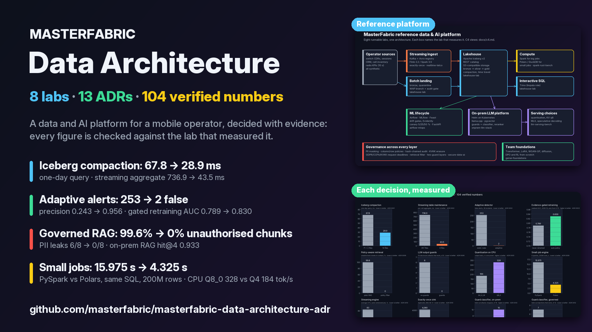
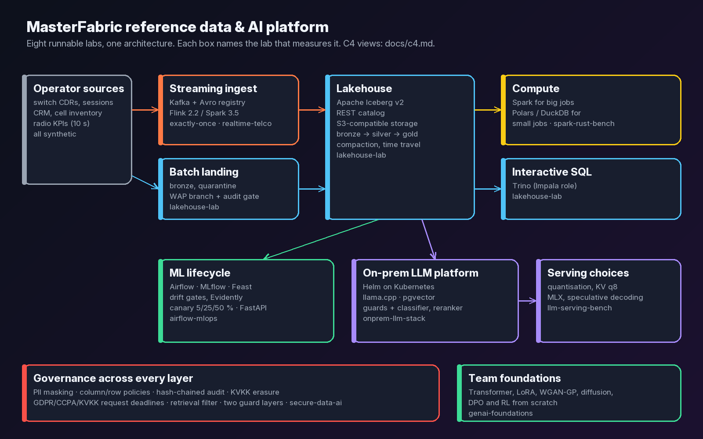
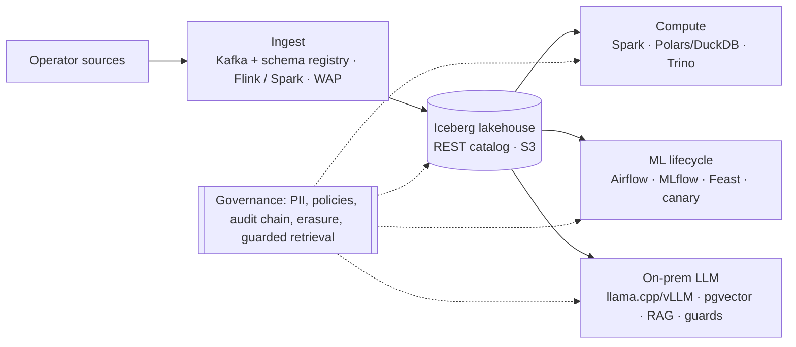
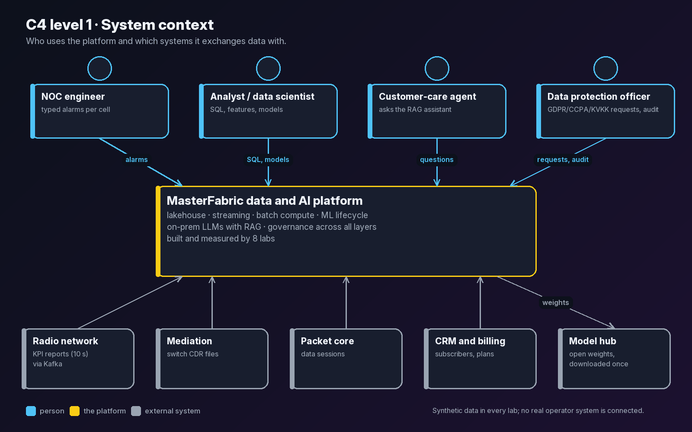
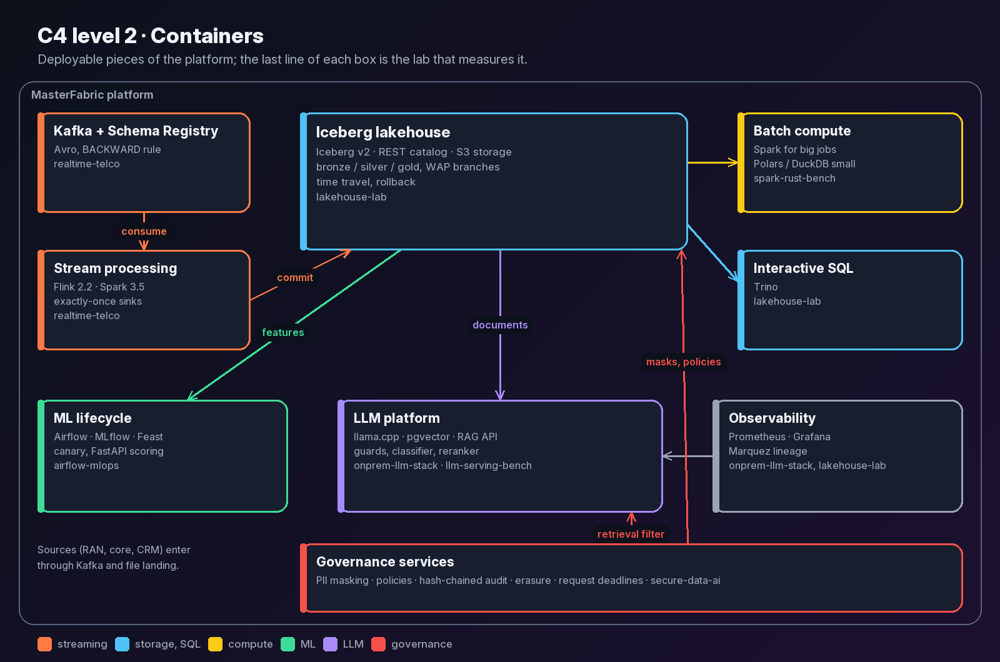
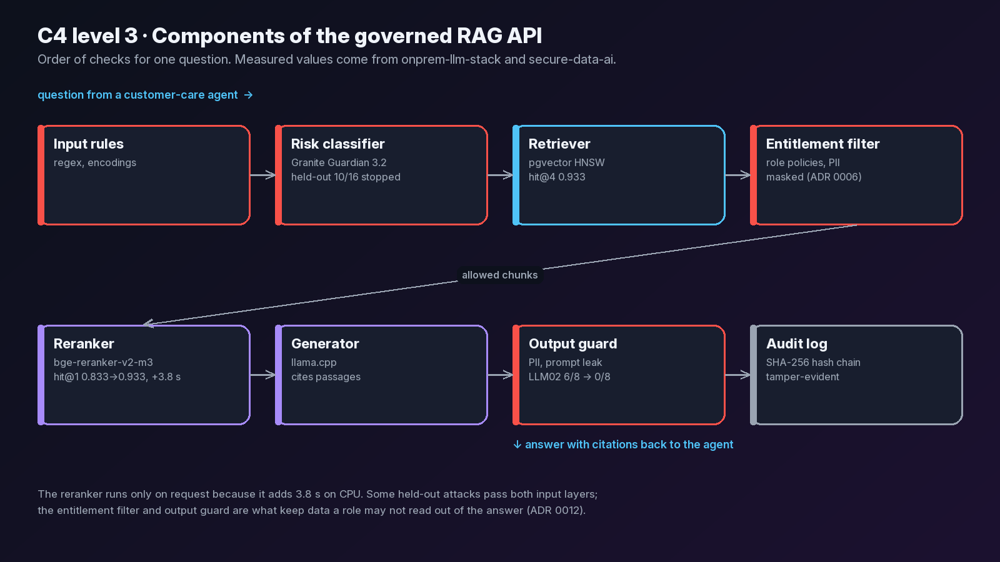
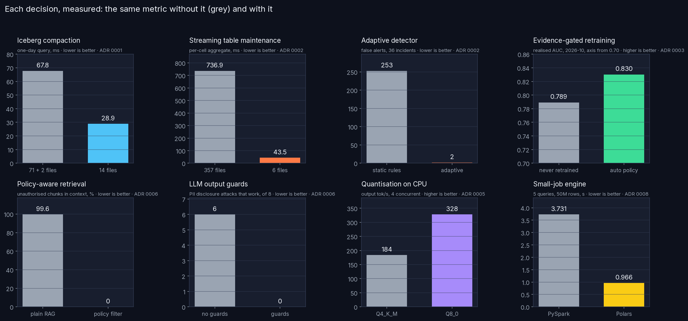
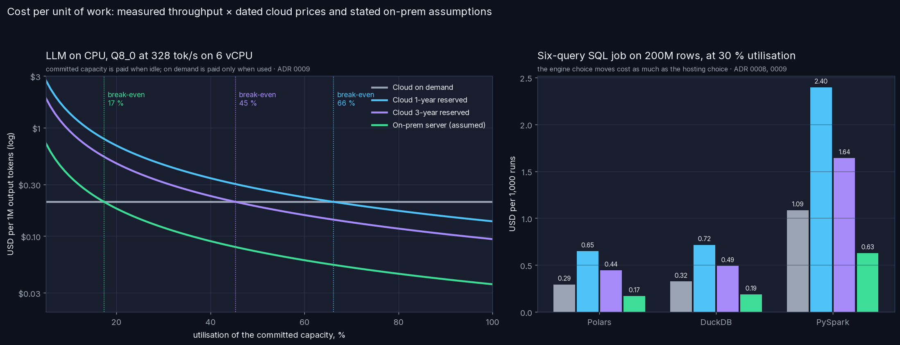
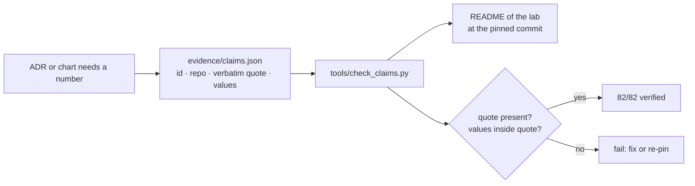

<p align="center"></p>

# MasterFabric Data Architecture

**A reference data and AI platform for a mobile operator, where every decision points to a lab
that ran it and every number is checked against that lab.**

Eight MasterFabric repositories each build and measure one part of the platform on a laptop:
lakehouse, streaming, MLOps, on-prem LLMs, LLM serving, data security, generative AI basics and
batch compute. This repository ties them together: twelve architecture decision records (ADRs),
C4 and Mermaid diagrams of the whole platform, a cost model built on measured throughput, a
Cloudera mapping, and a checker that verifies all 82 cited numbers against the source READMEs at
pinned commits.

```text
$ make check
82/82 claims verified (GitHub at pinned commits)
```

## The platform

<p align="center"></p>
<p align="center"><em>Figure 1. Sources, ingest, Iceberg lakehouse, compute, ML lifecycle and on-prem LLMs, with
governance across every layer. Each box names the lab that implements and measures it.</em></p>



Five more diagrams (the streaming path, a month of the model lifecycle with the canary, a governed
RAG request, choosing a compute path, and the Cloudera mapping) are in
[docs/architecture.md](docs/architecture.md).

## C4 views

The same platform at three [C4](https://c4model.com) zoom levels, as Mermaid in
[docs/c4.md](docs/c4.md) and as images drawn by `viz/make_diagrams.py`.

<p align="center"></p>
<p align="center"><em>Figure 2. Level 1, system context: four roles use the platform and five external systems
exchange data with it. All lab data is synthetic.</em></p>

<p align="center"></p>
<p align="center"><em>Figure 3. Level 2, containers: the deployable pieces, the data flowing between them, and the lab
that measures each one.</em></p>

<p align="center"></p>
<p align="center"><em>Figure 4. Level 3, the governed RAG API: the order of checks for one question, with the measured
value of each layer.</em></p>

## Decisions and their evidence

<p align="center"></p>
<p align="center"><em>Figure 5. Each panel is one decision: the same metric without it (grey) and with it. The last
row is new: Flink vs Spark CPU, exactly-once vs at-least-once duplicates, and the two guard
classifiers on held-out attacks. Values come from evidence/claims.json.</em></p>

| ADR | Decision | Key measured evidence | Lab |
|---|---|---|---|
| [0001](docs/adr/0001-iceberg-lakehouse.md) | Open lakehouse on Iceberg with a REST catalog, publish through WAP | 8× the data for 2.1× the time; one-day query 67.8 → 28.9 ms after compaction; bad batch 8/11 audit, 0 rows visible on `main`; rollback 0.057 s | [lakehouse-lab](https://github.com/masterfabric/masterfabric-lakehouse-lab) |
| [0002](docs/adr/0002-streaming-event-time.md) | Kafka + Spark Streaming on event time, adaptive detection | 36/36 incidents, 2 false alerts (static rules: 253); p50 9.8 s to alert; incompatible schema rejected with 409 | [realtime-telco](https://github.com/masterfabric/masterfabric-realtime-telco) |
| [0003](docs/adr/0003-gated-ml-lifecycle.md) | ML lifecycle gated by data quality and evidence | realised AUC 0.830 vs 0.789 never retrained; broken month halted; rollback in 3.41 s; champion now v5 (ADR 0011) | [airflow-mlops](https://github.com/masterfabric/masterfabric-airflow-mlops) |
| [0004](docs/adr/0004-onprem-llm-platform.md) | On-prem LLMs, RAG and layered guardrails on Kubernetes | hit@4 0.933; accuracy 0.767; 22/26 attacks handled by rules, 24/26 with the classifier; reranker hit@1 0.833 → 0.933 | [onprem-llm-stack](https://github.com/masterfabric/masterfabric-onprem-llm-stack) |
| [0005](docs/adr/0005-measure-serving-choices.md) | Serving hardware and quantisation chosen by measurement | CPU: Q8_0 328 vs Q4_K_M 184 tok/s; GPU: 381 vs 358; TTFT 1.91 s vs 13.83 s; MLX 210 vs 171 tok/s; speculative 1.60x / 1.73x on code | [llm-serving-bench](https://github.com/masterfabric/masterfabric-llm-serving-bench) |
| [0006](docs/adr/0006-govern-data-before-ai.md) | Governance enforced before data reaches a model | PII precision 0.986; 0 of 50 bypasses; unauthorised chunks 99.6% → 0; audit chain 3/3 tamper drills; erasure 0 residual rows | [secure-data-ai](https://github.com/masterfabric/masterfabric-secure-data-ai) |
| [0007](docs/adr/0007-understand-the-models.md) | First-principles team knowledge; LoRA for adaptation | attention within 1.5e-7 of SDPA; LoRA 1.758 vs 1.725 full FT; WGAN-GP and diffusion 8 of 8 modes; DPO reward 0.749 → 0.786 | [genai-foundations](https://github.com/masterfabric/masterfabric-genai-foundations) |
| [0008](docs/adr/0008-two-compute-paths.md) | Spark for big jobs, a single-node engine (Polars or DuckDB) for small ones | 200M rows: 4.325 s (Polars), 4.777 s (DuckDB) vs 15.975 s (PySpark); 234 of 234 identical; Python UDF 24.754 s vs built-in 0.846 s | [spark-rust-bench](https://github.com/masterfabric/masterfabric-spark-rust-bench) |
| [0009](docs/adr/0009-cost-onprem-vs-cloud.md) | Place workloads by measured cost per unit of work | on-prem beats on demand above 17 % utilisation; Q8 LLM $0.207 vs $0.120 per 1M tokens at 30 %; engine and format choices are 1.8x to 6.9x | cost model below |
| [0010](docs/adr/0010-streaming-engine.md) | Flink for new low-latency streams; Spark where Spark already runs | Flink 3.07 s vs Spark 10.54 s, CPU 12 % vs 83 %; exactly-once 0 vs 4,080 duplicates | [realtime-telco](https://github.com/masterfabric/masterfabric-realtime-telco) |
| [0011](docs/adr/0011-release-models-through-canary.md) | Release models through a canary and a feature store | v6 rolled back at 5 %; v5 promoted (ΔAUC −0.0007); 0 of 194,913 rows differ in point-in-time joins | [airflow-mlops](https://github.com/masterfabric/masterfabric-airflow-mlops) |
| [0012](docs/adr/0012-evaluate-guards-on-held-out-attacks.md) | Judge LLM guardrails on held-out attacks and legitimate traffic | held-out: 0/16 → 10/16 stopped (on-prem), 7/12 → 1/12 succeed (governed); 3/22 legitimate questions blocked | [onprem-llm-stack](https://github.com/masterfabric/masterfabric-onprem-llm-stack), [secure-data-ai](https://github.com/masterfabric/masterfabric-secure-data-ai) |

ADRs 0001-0008 each carry a dated "Update 2026-11-21" section that re-states the decision with the
new evidence and points to the ADR that extends it.

## Cost per unit of work

<p align="center"></p>
<p align="center"><em>Figure 6. Left: cost of one million Q8_0 output tokens on CPU against how busy the committed
capacity is; on demand is flat because idle time is not paid. Right: cost of 1,000 runs of the
six-query, 200M-row SQL job at 30 % utilisation.</em></p>

`tools/cost_model.py` multiplies **measured throughput** (verified claims: 328 and 184 tok/s on CPU,
the 200M-row SQL sums, Flink and Spark CPU) by **dated prices** (AWS m7g.2xlarge in US East:
$0.3264 an hour on demand, $0.216 1-year reserved, $0.148 3-year reserved, from instances.vantage.sh
on 2026-11-21) and **stated on-prem assumptions** (a $20,000, 128 vCPU server over 5 years, 0.6 kW,
PUE 1.5, $0.12/kWh, 15 % operations). Inputs are in `evidence/cost_inputs.json`; `make cost`
writes `evidence/cost_model.json`.

| Per vCPU-hour of committed capacity | Cloud on demand | 1-year reserved | 3-year reserved | On-prem (assumed) |
|---|---:|---:|---:|---:|
| Price | $0.0408 | $0.0270 | $0.0185 | $0.0071 |
| Break-even utilisation against on demand | – | 66 % | 45 % | 17 % |
| Q8 LLM, $ per 1M tokens at 30 % | 0.207 | 0.457 | 0.313 | 0.120 |
| Q8 LLM, $ per 1M tokens at 100 % | 0.207 | 0.137 | 0.094 | 0.036 |

The choices made before hosting move cost as much: PySpark needs 3.7x the CPU time of Polars for the
same SQL, Spark 6.9x the CPU of Flink for the same stream, and Q4_K_M 1.8x the cost of Q8_0 per token
on CPU. [ADR 0009](docs/adr/0009-cost-onprem-vs-cloud.md) turns this into placement rules.

## How numbers are verified



The charts and the hero read their values from the same file, so an image cannot show a number the
checker has not verified. The cost model reads the same verified values. Tests (`make test`,
10 tests) cover the claim file, the failure path and the cost arithmetic.

## Mapping to a Cloudera estate

| Layer | Lab implementation | Cloudera Data Platform |
|---|---|---|
| Streaming | Kafka KRaft, Avro schema registry, Flink 2.2, Spark Structured Streaming | Streams Messaging (Kafka, Schema Registry), CSA (Flink), CDE Spark |
| Lakehouse | Iceberg v2, REST catalog, S3-compatible storage, WAP branches, OpenLineage + Marquez | Iceberg in CDP, Ozone or S3, Atlas lineage |
| Batch compute | Spark 3.5, Polars, DuckDB | Cloudera Data Engineering; single-node jobs in CML |
| Interactive SQL | Trino | Cloudera Data Warehouse (Impala, Hive) |
| ML lifecycle | Airflow, MLflow, Feast, Evidently, FastAPI canary | CDE Airflow, Cloudera Machine Learning registry, feature store and serving |
| LLM serving | Helm chart, llama.cpp / vLLM, pgvector, reranker, Prometheus + Grafana | Cloudera AI Inference service, CML on GPU nodes |
| Governance | PII detectors, role policies, retrieval filter, hash-chained audit, erasure | Ranger, Atlas, Cloudera Data Catalog (SDX) |

## Quickstart

```bash
git clone https://github.com/masterfabric/masterfabric-data-architecture-adr
cd masterfabric-data-architecture-adr
make venv          # Python 3.12 + pinned requirements
make check         # verify all claims against GitHub (needs internet)
make test          # 10 tests
make cost          # recompute evidence/cost_model.json
make charts        # re-render the evidence and cost charts, platform and C4 diagrams, hero
```

With the eight labs cloned next to this repository, `make check-local` verifies offline.

## Limitations

- **The labs are separate.** Each lab runs on its own; the arrows between them show the target
  architecture, not a deployed integration. For example, airflow-mlops generates its own snapshots
  rather than reading the lakehouse-lab tables.
- **Laptop scale.** Every number comes from one Apple M4 Pro, mostly inside a 6 vCPU Colima VM, with
  synthetic data. They show behaviour and trade-offs, not production capacity.
- **The checker proves sourcing, not correctness.** It shows each number is what the lab reports at
  the pinned commit; the labs' own tests and limitations cover whether the measurement is right.
- **The cost model is a model.** Throughput is measured; cloud prices are list prices for one
  instance type and region on one date; the on-prem figures are assumptions, not a quote, and leave
  out staff, network, licences and spare capacity. Re-run `make cost` with real quotes before deciding.
- **C4 views show the target.** Containers drawn as connected (for example Flink writing to the
  lakehouse that the RAG API reads) run in separate labs today.
- **Not measured here:** GPU serving with vLLM, multi-node Spark or Flink, and the Cloudera services
  in the mapping table. Flink was measured on one job on one machine.

## Roadmap

- Wire the labs end to end: streaming and batch into one Iceberg catalog, MLOps and RAG reading it.
- Re-run `make check` whenever a lab is re-pinned, and re-run the cost model with real quotes.
- ADRs for identity (Kerberos/OIDC) and data contracts across teams.

## The labs

| # | Repository | What it shows |
|---|---|---|
| 1 | [masterfabric-lakehouse-lab](https://github.com/masterfabric/masterfabric-lakehouse-lab) | Iceberg lakehouse with Spark, Trino and S3 storage; WAP publishing, lineage |
| 2 | [masterfabric-realtime-telco](https://github.com/masterfabric/masterfabric-realtime-telco) | Kafka, schema registry, Spark and Flink streaming, exactly-once, adaptive detection |
| 3 | [masterfabric-airflow-mlops](https://github.com/masterfabric/masterfabric-airflow-mlops) | Twelve months of a churn model under Airflow and MLflow; Feast, Evidently, canary (champion v5) |
| 4 | [masterfabric-onprem-llm-stack](https://github.com/masterfabric/masterfabric-onprem-llm-stack) | Helm-packaged LLM, RAG, guard classifier, reranker and monitoring on Kubernetes |
| 5 | [masterfabric-llm-serving-bench](https://github.com/masterfabric/masterfabric-llm-serving-bench) | LLM serving: quantisation, KV cache, GPU vs CPU, MLX, speculative decoding |
| 6 | [masterfabric-secure-data-ai](https://github.com/masterfabric/masterfabric-secure-data-ai) | KVKK PII masking, role policies, guarded RAG, OWASP LLM tests, audit chain, erasure |
| 7 | [masterfabric-genai-foundations](https://github.com/masterfabric/masterfabric-genai-foundations) | Transformer, LoRA, GAN, WGAN-GP, diffusion, DPO and RL from scratch in PyTorch |
| 8 | [masterfabric-spark-rust-bench](https://github.com/masterfabric/masterfabric-spark-rust-bench) | PySpark, Scala Spark, Polars, DuckDB and DataFusion on the same SQL, up to 200M rows, Iceberg |

## License

Copyright (c) 2026 MasterFabric. Licensed under the [GNU Affero General Public License v3.0](LICENSE)
with the attribution and trademark terms in [NOTICE](NOTICE). See also [CONTRIBUTING](CONTRIBUTING.md),
[CODE_OF_CONDUCT](CODE_OF_CONDUCT.md) and [SECURITY](SECURITY.md). Build history:
[docs/TIMELINE.md](docs/TIMELINE.md).
