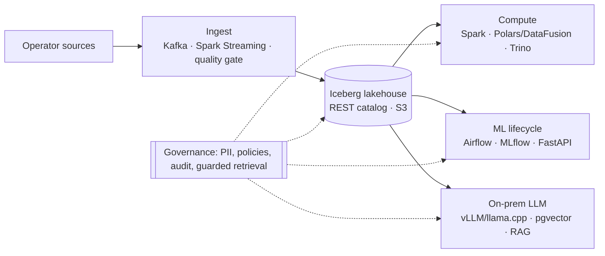

<p align="center"></p>

# MasterFabric Data Architecture

**A reference data and AI platform for a mobile operator, where every decision points to a lab
that ran it and every number is checked against that lab.**

Eight MasterFabric repositories each build and measure one part of the platform on a laptop:
lakehouse, streaming, MLOps, on-prem LLMs, LLM serving, data security, generative AI basics and
batch compute. This repository ties them together: eight architecture decision records (ADRs),
Mermaid diagrams of the whole platform, a Cloudera mapping, and a checker that verifies all 55
cited numbers against the source READMEs at pinned commits.

```text
$ make check
55/55 claims verified (GitHub at pinned commits)
```

## The platform

<p align="center"></p>
<p align="center"><em>Sources, ingest, Iceberg lakehouse, compute, ML lifecycle and on-prem LLMs, with governance across
every layer. Each box names the lab that implements and measures it.</em></p>



Five more diagrams (the streaming path, a month of the model lifecycle, a governed RAG request,
choosing a compute path, and the Cloudera mapping) are in [docs/architecture.md](docs/architecture.md).

## Decisions and their evidence

<p align="center"></p>
<p align="center"><em>Each panel is one decision: the same metric without it (grey) and with it. Values come from
evidence/claims.json.</em></p>

| ADR | Decision | Key measured evidence | Lab |
|---|---|---|---|
| [0001](docs/adr/0001-iceberg-lakehouse.md) | Open lakehouse on Iceberg with a REST catalog | 8× the data for 2.1× the time; one-day query 67.8 → 28.9 ms after compaction; Trino 135 ms | [lakehouse-lab](https://github.com/masterfabric/masterfabric-lakehouse-lab) |
| [0002](docs/adr/0002-streaming-event-time.md) | Kafka + Spark Streaming on event time, adaptive detection | 36/36 incidents, 2 false alerts (static rules: 253); p50 9.8 s to alert; 125,611 events/s | [realtime-telco](https://github.com/masterfabric/masterfabric-realtime-telco) |
| [0003](docs/adr/0003-gated-ml-lifecycle.md) | ML lifecycle gated by data quality and evidence | realised AUC 0.830 vs 0.789 never retrained; broken month halted; rollback in 3.41 s | [airflow-mlops](https://github.com/masterfabric/masterfabric-airflow-mlops) |
| [0004](docs/adr/0004-onprem-llm-platform.md) | On-prem LLMs, RAG and layered guardrails on Kubernetes | hit@4 0.933; accuracy 0.767; 22/26 attacks handled, 0/4 paraphrases caught | [onprem-llm-stack](https://github.com/masterfabric/masterfabric-onprem-llm-stack) |
| [0005](docs/adr/0005-measure-serving-choices.md) | Serving hardware and quantisation chosen by measurement | CPU: Q8_0 328 vs Q4_K_M 184 tok/s; GPU: 381 vs 358; TTFT 1.91 s vs 13.83 s | [llm-serving-bench](https://github.com/masterfabric/masterfabric-llm-serving-bench) |
| [0006](docs/adr/0006-govern-data-before-ai.md) | Governance enforced before data reaches a model | PII precision 0.986; 0 of 50 bypasses; unauthorised chunks 99.6% → 0; injection 7/10 → 4/10 | [secure-data-ai](https://github.com/masterfabric/masterfabric-secure-data-ai) |
| [0007](docs/adr/0007-understand-the-models.md) | First-principles team knowledge; LoRA for adaptation | attention within 1.5e-7 of SDPA; LoRA 1.758 vs 1.725 full FT, less forgetting (1.642 vs 1.747) | [genai-foundations](https://github.com/masterfabric/masterfabric-genai-foundations) |
| [0008](docs/adr/0008-two-compute-paths.md) | Spark for big jobs, a single-node Rust engine for small ones | same SQL 0.966 s (Polars) vs 3.731 s (PySpark), 60/60 identical; Python UDF 6.613 s vs built-in 0.273 s | [spark-rust-bench](https://github.com/masterfabric/masterfabric-spark-rust-bench) |

## How numbers are verified


The charts and the hero read their values from the same file, so an image cannot show a number the
checker has not verified. Tests (`make test`, 5 tests) cover the claim file and the failure path.

## Mapping to a Cloudera estate

| Layer | Lab implementation | Cloudera Data Platform |
|---|---|---|
| Streaming | Kafka KRaft, Spark Structured Streaming | Streams Messaging (Kafka), CDE Spark or CSA (Flink) |
| Lakehouse | Iceberg v2, REST catalog, S3-compatible storage | Iceberg in CDP, Ozone or S3 |
| Batch compute | Spark 3.5, Polars, DataFusion | Cloudera Data Engineering; single-node jobs in CML |
| Interactive SQL | Trino | Cloudera Data Warehouse (Impala, Hive) |
| ML lifecycle | Airflow, MLflow, FastAPI | CDE Airflow, Cloudera Machine Learning registry and serving |
| LLM serving | Helm chart, llama.cpp / vLLM, pgvector | Cloudera AI Inference service, CML on GPU nodes |
| Governance | PII detectors, role policies, retrieval filter | Ranger, Atlas, Cloudera Data Catalog (SDX) |

## Quickstart

```bash
git clone https://github.com/masterfabric/masterfabric-data-architecture-adr
cd masterfabric-data-architecture-adr
make venv          # Python 3.12 + pinned requirements
make check         # verify all claims against GitHub (needs internet)
make test          # 5 tests
make charts        # re-render the evidence chart, platform diagram and hero
```

With the eight labs cloned next to this repository, `make check-local` verifies offline.

## Limitations

- **The labs are separate.** Each lab runs on its own; the arrows between them show the target
  architecture, not a deployed integration. For example, airflow-mlops generates its own snapshots
  rather than reading the lakehouse-lab tables.
- **Laptop scale.** Every number comes from one Apple M4 Pro, mostly inside a 6 vCPU Colima VM, with
  synthetic data. They show behaviour and trade-offs, not production capacity.
- **The checker proves sourcing, not correctness.** It shows each number is what the lab reports at
  the pinned commit; the labs' own tests and limitations cover whether the measurement is right.
- **Not measured here:** GPU serving with vLLM, multi-node Spark, Flink, and the Cloudera services in
  the mapping table.

## Roadmap

- Wire the labs end to end: streaming and batch into one Iceberg catalog, MLOps and RAG reading it.
- Add a GitHub Actions job that runs `make check` on a schedule and whenever a lab is re-pinned.
- ADRs for identity (Kerberos/OIDC), data contracts across teams, and cost per workload.

## The labs

| # | Repository | What it shows |
|---|---|---|
| 1 | [masterfabric-lakehouse-lab](https://github.com/masterfabric/masterfabric-lakehouse-lab) | Iceberg lakehouse with Spark, Trino and S3 storage |
| 2 | [masterfabric-realtime-telco](https://github.com/masterfabric/masterfabric-realtime-telco) | Kafka and Spark streaming with adaptive anomaly detection |
| 3 | [masterfabric-airflow-mlops](https://github.com/masterfabric/masterfabric-airflow-mlops) | Twelve months of a churn model under Airflow and MLflow |
| 4 | [masterfabric-onprem-llm-stack](https://github.com/masterfabric/masterfabric-onprem-llm-stack) | Helm-packaged LLM, RAG and guardrails on Kubernetes |
| 5 | [masterfabric-llm-serving-bench](https://github.com/masterfabric/masterfabric-llm-serving-bench) | LLM serving: quantisation, KV cache, GPU vs CPU |
| 6 | [masterfabric-secure-data-ai](https://github.com/masterfabric/masterfabric-secure-data-ai) | KVKK PII masking, role policies, guarded RAG, OWASP LLM tests |
| 7 | [masterfabric-genai-foundations](https://github.com/masterfabric/masterfabric-genai-foundations) | Transformer, LoRA, GAN and RL from scratch in PyTorch |
| 8 | [masterfabric-spark-rust-bench](https://github.com/masterfabric/masterfabric-spark-rust-bench) | PySpark, Scala Spark, Polars and DataFusion on the same SQL |

## License

Copyright (c) 2026 MasterFabric. Licensed under the [GNU Affero General Public License v3.0](LICENSE)
with the attribution and trademark terms in [NOTICE](NOTICE). See also [CONTRIBUTING](CONTRIBUTING.md),
[CODE_OF_CONDUCT](CODE_OF_CONDUCT.md) and [SECURITY](SECURITY.md). Build history:
[docs/TIMELINE.md](docs/TIMELINE.md).
