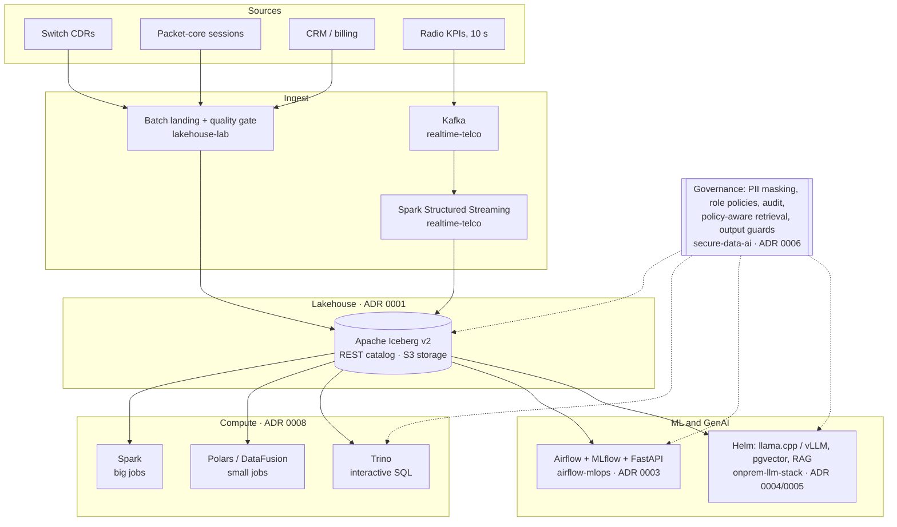
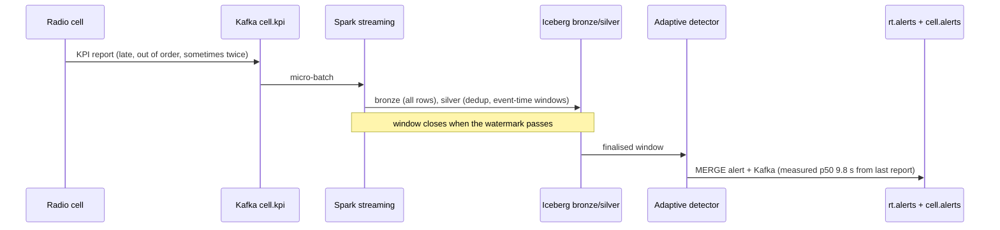
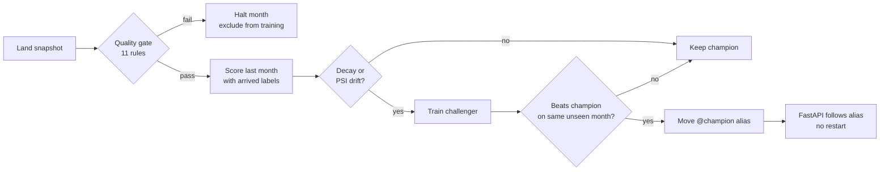
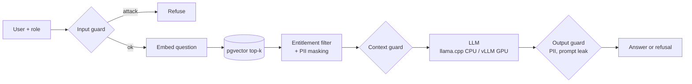
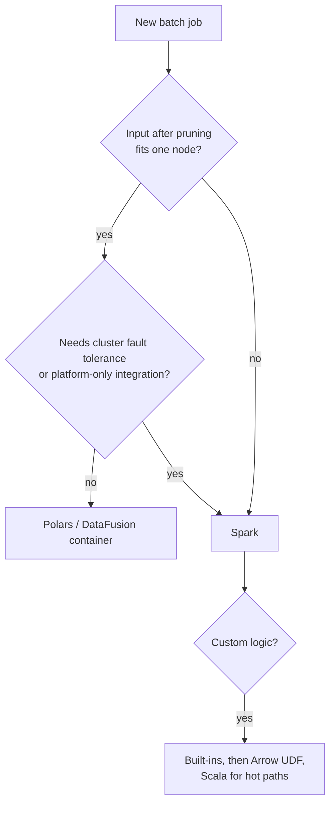

# Reference architecture in diagrams

All diagrams are Mermaid, so GitHub renders them and they stay editable in review. Lab names in
brackets point to the repository that runs and measures that part.

## 1. Platform layers

## 2. Streaming path, from report to alert (ADR 0002)

## 3. Model lifecycle, one month (ADR 0003)

## 4. A governed RAG request (ADR 0004 and 0006)

## 5. Choosing a compute path for a new job (ADR 0008)

## 6. Mapping to a Cloudera estate

| Layer | Lab implementation | Cloudera Data Platform |
|---|---|---|
| Streaming | Kafka KRaft, Spark Structured Streaming | Streams Messaging (Kafka), CDE Spark or CSA (Flink) |
| Lakehouse | Iceberg v2, REST catalog, S3-compatible storage | Iceberg in CDP, HMS/REST catalog, Ozone or S3 |
| Batch compute | Spark 3.5, Polars, DataFusion | Cloudera Data Engineering; single-node jobs in CML |
| Interactive SQL | Trino | Cloudera Data Warehouse (Impala, Hive) |
| ML lifecycle | Airflow, MLflow, FastAPI | CDE Airflow, Cloudera Machine Learning registry and serving |
| LLM serving | Helm chart, llama.cpp / vLLM, pgvector | Cloudera AI Inference service, CML on GPU nodes |
| Governance | PII detectors, role policies, retrieval filter | Ranger, Atlas, Cloudera Data Catalog (SDX) |
