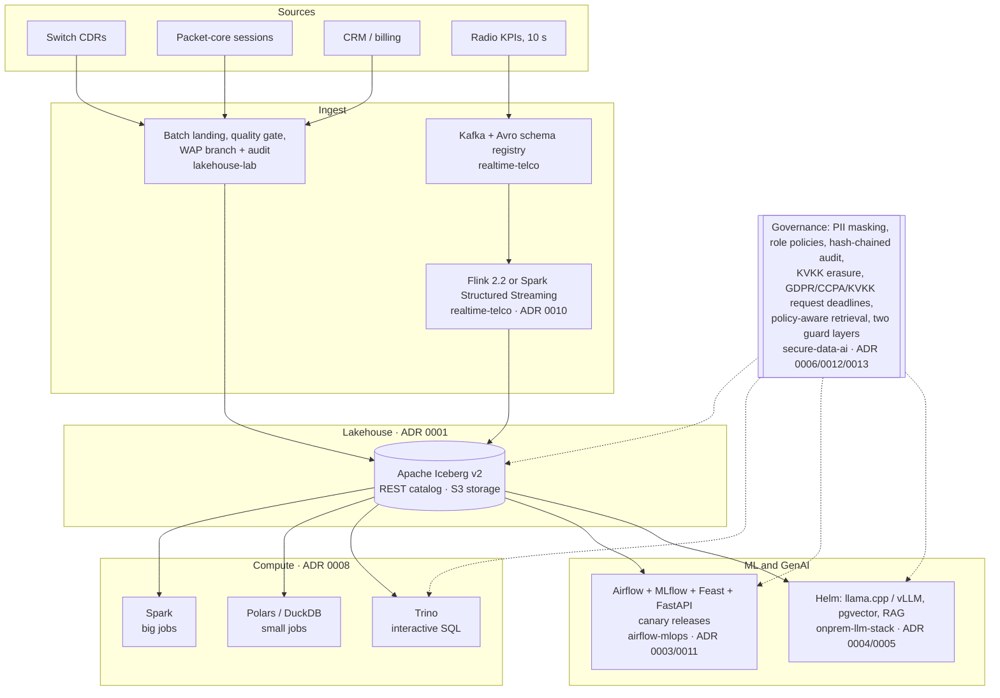
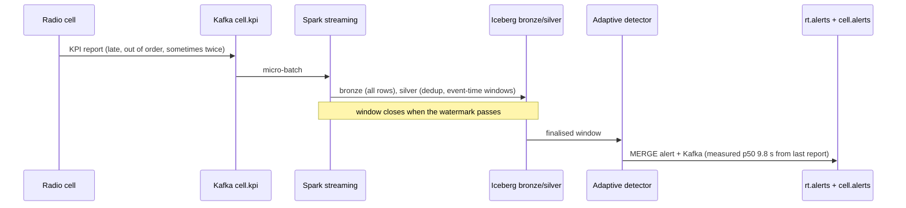
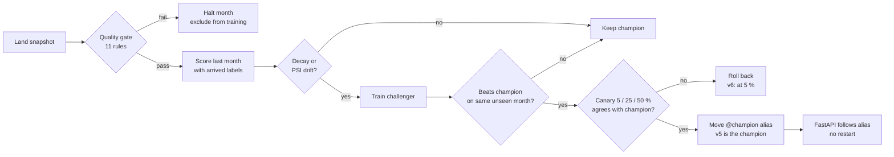
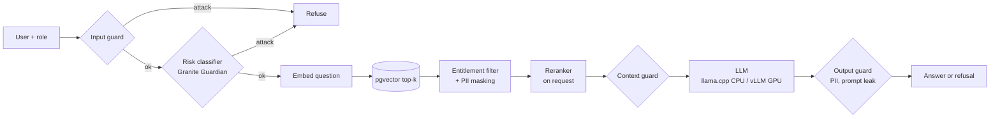
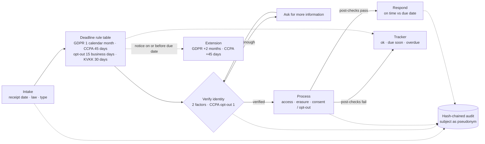
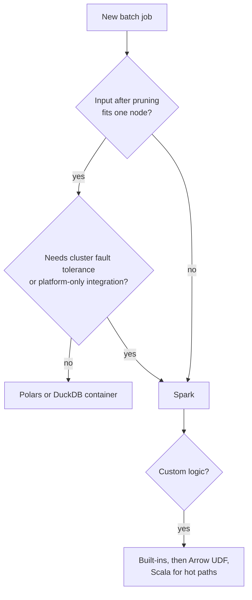

# Reference architecture in diagrams

All diagrams are Mermaid, so GitHub renders them and they stay editable in review. Lab names in
brackets point to the repository that runs and measures that part. The same platform as C4 context,
container and component views is in [c4.md](c4.md); cost per unit of work is in
[ADR 0009](adr/0009-cost-onprem-vs-cloud.md).

## 1. Platform layers

## 2. Streaming path, from report to alert (ADR 0002)

Shown with the Spark job the lab started with; the Flink job (ADR 0010) computes the same windows (identical results) and
drained the same 1.04M records in 3.07 s instead of 10.54 s.

## 3. Model lifecycle, one month (ADR 0003, 0011)

## 4. A governed RAG request (ADR 0004, 0006 and 0012)

## 5. A data-subject request, intake to response (ADR 0006 and 0013)

Not legal advice: the periods are one simplified engineering reading; see the
[comparison in secure-data-ai](https://github.com/masterfabric/masterfabric-secure-data-ai/blob/main/docs/dsr-gdpr-ccpa-kvkk.md).

## 6. Choosing a compute path for a new job (ADR 0008)

## 7. Mapping to a Cloudera estate

| Layer | Lab implementation | Cloudera Data Platform |
|---|---|---|
| Streaming | Kafka KRaft, Avro schema registry, Flink 2.2, Spark Structured Streaming | Streams Messaging (Kafka, Schema Registry), CSA (Flink), CDE Spark |
| Lakehouse | Iceberg v2, REST catalog, S3-compatible storage, WAP branches, OpenLineage + Marquez | Iceberg in CDP, HMS/REST catalog, Ozone or S3, Atlas lineage |
| Batch compute | Spark 3.5, Polars, DuckDB | Cloudera Data Engineering; single-node jobs in CML |
| Interactive SQL | Trino | Cloudera Data Warehouse (Impala, Hive) |
| ML lifecycle | Airflow, MLflow, Feast, Evidently, FastAPI canary | CDE Airflow, Cloudera Machine Learning registry, feature store and serving |
| LLM serving | Helm chart, llama.cpp / vLLM, pgvector, reranker, Prometheus + Grafana | Cloudera AI Inference service, CML on GPU nodes |
| Governance | PII detectors, role policies, retrieval filter, hash-chained audit, erasure, request deadlines | Ranger, Atlas, Cloudera Data Catalog (SDX) |
