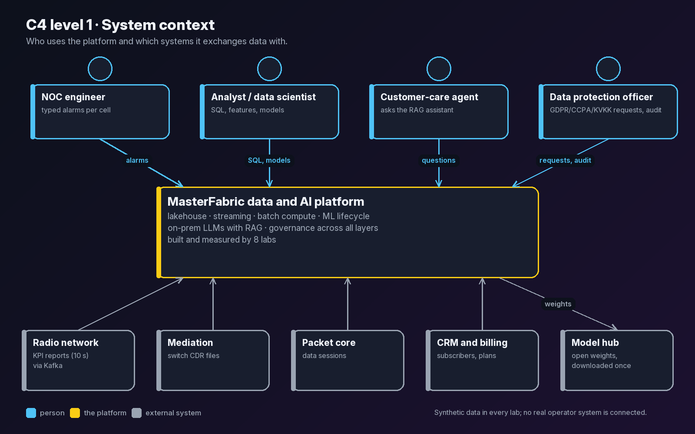
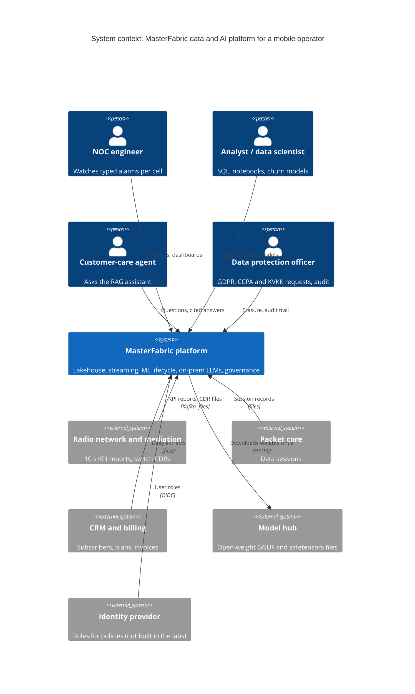
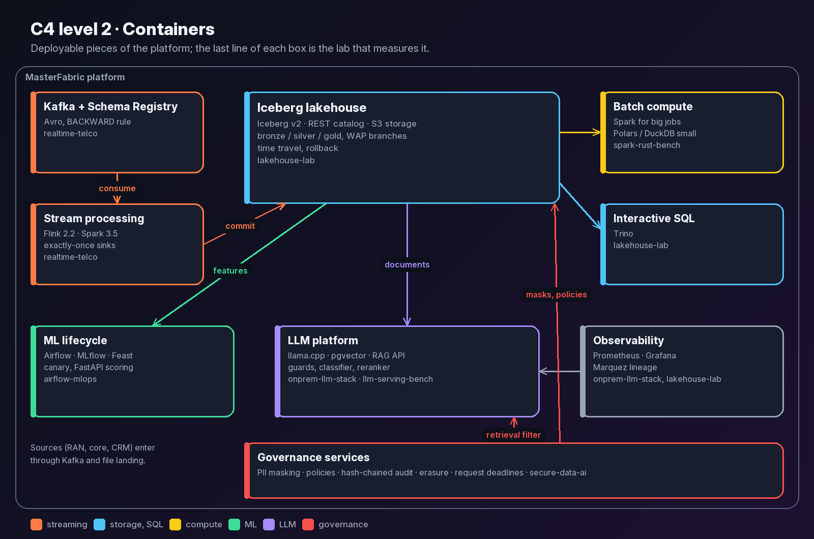
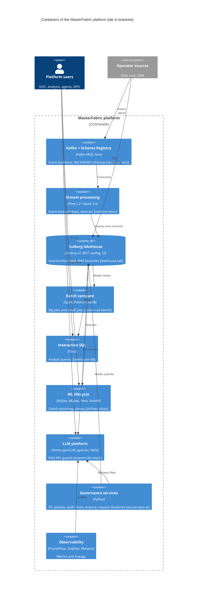
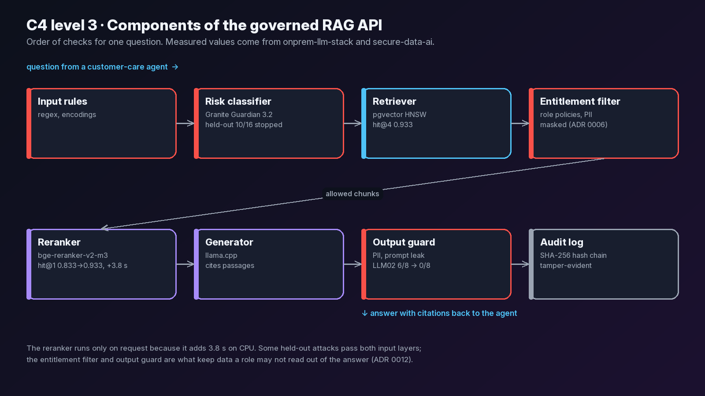
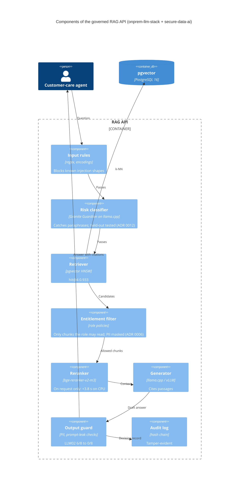

# C4 model of the platform

The [C4 model](https://c4model.com) describes a system at four zoom levels. This file gives the first
three for the MasterFabric reference platform: **context** (who uses it and what it talks to),
**containers** (the deployable pieces) and **components** of the one container where most risk sits,
the governed RAG API. Each element names the lab that builds and measures it; numbers are in the
ADRs and verified by `make check`. The PNG versions (`docs/images/c4_*.png`) are drawn by
`viz/make_diagrams.py` from the same element lists.

As in the README's limitations: the labs run separately; these diagrams show the target architecture
that the labs implement piece by piece.

## Level 1: system context

## Level 2: containers

## Level 3: components of the governed RAG API

